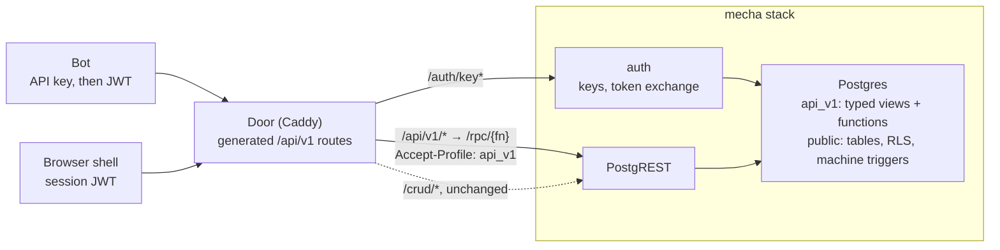

# Pronto App API Export — Design Doc

Design, not built (redesigned 2026-11-11, PRONTO-374). It replaces the gRPC design of PRONTO-344 (the [first version](https://github.com/bsoneca/pronto-plugins/blob/66aaf80/docs/pronto-api.md), kept in history).

## Summary

We add **pronto-api**, a plugin that exports a pronto app's data and operations as a REST/JSON API. It is **PostgREST served over typed views**: the plugin generates a Postgres schema per major version, `api_v1`, that holds one typed view per exported resource (the public shape: explicit column types, public names and computed fields) and one SQL function per API method. The door routes Google-style URLs (`GET /api/v1/matches/{match}`, `POST /api/v1/matches/{match}:move`) to those functions through the PostgREST every app already runs. The REST surface follows [Google's API design guide](https://docs.cloud.google.com/apis/design): resource names, standard and custom methods, the canonical error codes, and the major version in the path.

There is no gRPC, Connect, protobuf or buf, and no new service. The API is SQL and a block of door routes, all generated from one author-edited file, `api_spec.cue`, and the app's `program.cue`. It is accepted when two bots holding API keys play complete Bonk Chess matches over it, and the same plugin installed on guestbook works with no chess-specific code.

Postgres stays the only authority. Views are `security_invoker` and the functions are `SECURITY INVOKER`, so RLS, CEL checks and machine guards judge every call as the caller: an API client can do exactly what the same user can do in the browser, and nothing more.

**What changed from the gRPC design, and why**

| Before (PRONTO-344) | Now | Why |
| --- | --- | --- |
| A Deno `api` service (connect-es) transcoding gRPC, Connect and REST to `/crud` | No service: the door rewrites each route to a PostgREST call on `api_v1` | The service only translated names and errors; SQL functions do both, in the same transaction as the write |
| CUE → `.proto` → descriptor set, `fields.lock.cue`, `buf breaking` | CUE → `api_v1` SQL, door routes, `openapi.json`, `contract.json` | No wire format to number; the contract is the JSON shape, guarded by a contract diff and by Postgres itself |
| Machine command = insert, then a second request to read the result back | One function inserts the command and reads the stored result in one transaction | The machine's AFTER INSERT trigger has run by the time the function selects the row |
| `Watch` (server stream) and a 25 s long-poll | Clients poll `Get` | A long-poll holds a PostgREST pool connection; chess bots need no more than one read a second |
| Native gRPC over HTTP/2 end to end on Cloud Run (h2c into Deno 2.9) | Plain HTTP through the door, as the shell's `/crud` | Nothing new on the wire |

**Goals**

1. One install command (`pronto-api <app>`) and one author-edited file (`api_spec.cue`) export an app. The `api_v1` SQL, the door routes and `openapi.json` are generated, never hand-written.
2. The REST surface reads like a Google API: resource-oriented, standard methods, AIP error codes, and stable for the life of `v1`.
3. Bots get a durable identity: per-account API keys, exchanged for short-lived user tokens, never the service role.
4. Mecha machines are exported generically: each machine named in the spec becomes a resource with `Create`, `Get`, `List` and one custom method per exported event.
5. Validation is data: a CUE scenario plays Bonk Chess games end to end over the API in the gate, with the `http` step the runner already has.

**Non-goals:** a public developer program, OAuth for third-party apps, webhooks, push (watch or streaming) in `v1`, PostgREST's own query grammar as a public contract, an MCP server (it can be generated from `openapi.json` later), and exporting `tab`/`device` entities that have no server table.

## Context: how a pronto app talks to its server today

A pronto app has no RPC layer and no per-app HTTP routes: every write is a keyed row change to PostgREST, and every server rule is a Postgres constraint, RLS policy or trigger-backed state machine. That is the seam this design uses: the API is a second, stable PostgREST schema over the tables the app already has, not a second backend.

| Concern | How it works today | Where |
| --- | --- | --- |
| Program | `program.cue` declares `pronto.#App` with `state.entities` (fields, CEL checks, `durability`, `access`); SQL, HTML and JS are generated from it | `apps/*/program.cue` |
| Writes | Optimistic local write, IndexedDB outbox, then `POST/PATCH/DELETE /crud/<table>`; the door adds `Prefer: resolution=ignore-duplicates`, so a replayed POST is a no-op | `apps/*/docker/Caddyfile`, omnishell `docs/data.md` |
| Commands | Gestures are rows with deterministic ids (Bonk Chess `_command`, `Intent`: same click twice = one row); triggers advance state machines and raise on illegal transitions | `apps/brawl-chess/surface.cue`, `machines/*.js` |
| Functions | SQL functions reachable as `/crud/rpc/<fn>` | billing `service.ts` |
| Reads | `server` entities via `/crud/<table>?…` (PostgREST grammar); `live` entities via Electric shapes at `/electric/*`, gated by `/auth/shape` tokens | mecha `ARCHITECTURE.md` |
| Identity | HS256 JWT `{role, sub, handle, exp, guest?}`; `POST /auth/guest` mints a guest, passkeys promote it; sidecars use a pre-signed `service` token (`SERVICE_JWT`) | mecha `services/auth` |
| Plugins | Installer `bin/pronto-<name> <app>` writes `<name>_plugin.cue` (generated), `<name>_spec.cue` (author-edited), migrations, hatches and sidecars | `bsoneca/pronto-plugins` |
| Gates | `generate`, `lint`, `test`, `integrate@local`; scenarios are CUE with Playwright actors and an `http` step that already calls `/crud` as an actor | `tests/scenarios/schema.cue` |

What is missing for an external client: a stable contract (raw `/crud` exposes table names and RLS internals that change with migrations), a durable identity for a non-browser client (no API keys), a discoverable list of what may be called, and errors a client can branch on. PostgREST can serve all of that once it is pointed at a schema made for the API instead of at the app's tables.

## Design



Three layers, each generated from `api_spec.cue` and `program.cue`:

1. **Views** (`api_v1.<resource>`). One per exported resource: the columns the API shows, renamed to public field names, plus the standard fields `name`, `create_time`, `update_time` and `etag`. A view is `security_invoker` over the app's tables, so RLS on the tables still filters what the caller sees. It is the only place an internal table or column name meets a public one.
2. **Methods** (`api_v1.<method>` functions). One function per API method, `SECURITY INVOKER`, reading through the views and writing to the app's tables. Each validates its request, maps the outcome to a Google error code, and returns the view's row (or the List response). Reads are `STABLE`, so PostgREST answers them on `GET`; writes are `VOLATILE`, on `POST`.
3. **Routes** (a generated door hatch). Each Google route, a verb plus a path template, is rewritten to one PostgREST call: `GET` or `POST /rpc/<fn>` with `Accept-Profile`/`Content-Profile: api_v1`. The door moves everything but the body into headers: the resource name from the path into `X-Api-Name`, and each query parameter the route declares (`page_size`, `match_id`, `update_mask`, …) into `X-Api-Param-<name>`. It then drops the query string and any `Prefer` header, so no PostgREST grammar (`select=`, `order=`, filters) reaches PostgREST, and a function called on `POST` still gets its query parameters (PostgREST passes a `POST` function only its JSON body). Functions read them through `api_v1.request_name()` and `api_v1.request_param(name)`, over PostgREST's `request.headers`. A path not generated is `404` at the door; raw `/rpc` and the views in `api_v1` are never routed under `/api`, and the `/crud` block strips `Accept-Profile` and `Content-Profile`, so `/crud` cannot reach `api_v1` either.

### Why functions for every method, over views

PostgREST could serve the views directly (`GET /match?id=eq.…`) and even write through auto-updatable views. We use views for the shape and functions for every method instead, because:

- **Google's methods do not fit PostgREST's grammar.** `List` must answer `{matches: […], next_page_token}` with an opaque token (AIP-158), `Get` of a missing or hidden row must be `404 NOT_FOUND` (PostgREST answers `406` for an empty singular read), and custom methods (`:move`) have no PostgREST equivalent. A function returns exactly the AIP shape.
- **Writes are more than one row.** A machine command inserts a command row, records its `request_id`, then reads the outcome the trigger stored; a `Create` checks the user-specified id and the caller's scope. A function does it in one transaction, so a retried request either sees the whole effect or none.
- **Errors are ours to name.** A function raises `SQLSTATE 'PGRST'`, which PostgREST turns into the HTTP status and JSON body we choose, so every refusal is a Google code plus the app's own reason word (Errors, below).
- **The query grammar stays private.** Clients never send `select=`, `or=` or embeds, so the internal tables can change without a client noticing; only the views' columns are contract.

Views stay because they keep the contract and the internals apart: a migration that renames a table changes a view's body, not its columns, and Postgres refuses `CREATE OR REPLACE VIEW` that drops, renames or retypes a column, which is the first guard of `v1`'s stability.

Views are plain views, computed on read. A view materialized into a table (kept by triggers or CDC) is a later option for a read too slow as a view; nothing in `v1` needs one.

### Views have a strong schema

A view is the API's contract, so its shape is declared, never inferred from the tables under it (the owner, 2026-11-11: "this view must have strong schema (for api evolution)"):

- **Every column has an explicit type.** The generator casts each column to the type `api_spec.cue` declares or `program.cue` gives the field (`::text`, `::bigint`, `::timestamptz`, `::boolean`), so retyping a table column never retypes the API. A field whose type cannot be stated is a `generate` error.
- **Enums are Postgres types.** Each enum field is a Postgres enum in `api_v1` with the UPPER_SNAKE values the spec lists (`api_v1.match_phase`: `WAITING`, `PLAYING`, `FINISHED`). The view maps the table's value into it, so an unmapped internal value fails the cast instead of leaking.
- **Nullability is contract.** Postgres does not keep `NOT NULL` on view columns, so `contract.json` records each field's type and whether it may be null, and each column that must not be null is wrapped so a null raises. The additive-only check fails when a field is removed, retyped, renamed, or becomes nullable.
- **Postgres is the backstop.** `CREATE OR REPLACE VIEW` refuses to drop, rename or retype a column, so a migration that would break a view fails `integrate@local` (Versioning, below).

### What the installer writes

Following the existing plugin shape (billing, flags, analytics):

| File | Owner | Holds |
| --- | --- | --- |
| `api_plugin.cue` | generated, do not edit | The `#Api` schema the spec is checked against |
| `api_spec.cue` | app author | Which entities, functions and machines are exported, their public names and fields; the only hand-written input |
| `services/database/migrations/NN_api_v1.sql` | generated by `generate` | Schema `api_v1`: the typed views and the method functions (each with `SET search_path = pg_catalog, api_v1, public`); schema `api_private`, not exposed: `request` (idempotency); grants to `app_user`; committed, so `guard-generated` catches drift |
| `api_door.cue` | generated | The door's `/api/v1` routes as a hatch, which pronto renders into the app's Caddyfile: one rewrite per route, the path and declared query parameters moved into headers, `Accept-Profile`/`Content-Profile: api_v1`, and the Google error body for every error a function did not raise |
| `api/v1/openapi.json` | generated | OpenAPI 3.1 for the Google routes (not PostgREST's own `/` document, which describes `/rpc`) |
| `api/v1/contract.json` | generated | Every route, field and type, sorted; the additive-only check compares it with `released.json` |
| mecha `cluster.cue` option | installer | PostgREST's schemas become `public,api_v1` (`PGRST_DB_SCHEMAS`, a mecha-fork option, PRONTO-376; today `PGRST_DB_SCHEMA` is fixed to `public` for every app), so `/crud` keeps `public` as its default and is unchanged |
| `flags_spec.cue` entry | installer | Flag `api_export`: `default: false`, `local: true`; off, the door block is not mounted |

### The spec

An author names what to export and its public names; types, checks and access are read from `program.cue`, so nothing is restated:

```cue
api: {
  version: "v1"
  // a mecha machine: public collection -> its surface tables, checked against program.cue
  machines: matches: {
    machine: "chess_match"
    tables: { open: "chess_match_open", command: "chess_match_command", seat: "chess_match_seat", public: "chess_match_public" }
    create: "create"                          // the open kind Create sends
    methods: { join: "join" }                 // other open kinds, as custom methods
    events: ["move", "resign", "offer_draw", "accept_draw", "decline_draw"]  // custom methods :move, :resign, :offerDraw, …
    fields: { fen: "view.fen", moves: "view.moves", result: "view.result", reason: "view.reason", actions: "view.actions", seat: "seat", phase: "phase" }
  }
  // plain entities: public collection -> table, its fields, and which methods
  entities: players: { table: "player_card", fields: { display_name: "handle", rating: "rating" }, methods: ["get"] }
  entities: games:   { table: "player_game", parent: "players", fields: { result: "result", reason: "reason", match: "room" }, methods: ["get", "list"] }
  functions: {}
}
```

A spec that names a field the entity lacks, an event the machine does not declare, or a write on an entity whose access forbids it fails `generate`. Exporting is opt-in per method; nothing is public by default.

### Resources and methods (Google API design guide → PostgREST)

**Resource names** (AIP-122). Every view has a `name` column, `{collection}/{id}`, nested under a parent where the spec says so: `matches/{match}`, `players/{player}`, `players/{player}/games/{game}`. Collections are plural lowerCamelCase (`matches`, `players`); ids are the row's existing key, never a new one.

**Standard methods** (AIP-131 to 135) and **custom methods** (AIP-136):

| Method | HTTP | PostgREST call | Function body |
| --- | --- | --- | --- |
| `Get` | `GET /api/v1/{name=matches/*}` | `GET /rpc/get_match` | `select … from api_v1.match where name = request_name()`; none → `NOT_FOUND` |
| `List` | `GET /api/v1/{parent}/games?page_size=&page_token=` | `GET /rpc/list_games` | keyset by `name` after the token, `page_size` default 50, max 200; returns `{games, next_page_token}` |
| `Create` | `POST /api/v1/matches?match_id=` | `POST /rpc/create_match` | insert with the client-chosen id (AIP-133 `match_id`) or a new UUID; returns the resource; an existing id is `ALREADY_EXISTS`, unless the same `request_id` made it (a retry) |
| `Update` | `PATCH /api/v1/{name}?update_mask=` | `POST /rpc/update_<e>` | update only the masked fields (AIP-134), `etag` checked; returns the resource |
| `Delete` | `DELETE /api/v1/{name}` | `POST /rpc/delete_<e>` | delete by name; returns `{}` (AIP-135) |
| custom | `POST /api/v1/{name}:verb` | `POST /rpc/<verb>_<e>` | the machine event or the exported SQL function (below) |

The door turns `PATCH` and `DELETE` into `POST` on the function, since PostgREST calls functions on `GET` and `POST` only. Request fields come from the JSON body; the resource name and the declared query parameters from headers the door sets (Routes, above). A `GET` function takes no arguments.

**Naming** (AIP-140, AIP-142). Fields are lower_snake_case and timestamps end in `_time` (`create_time`), as in Google's proto definitions. JSON keeps snake_case rather than proto3 JSON's lowerCamelCase, because there is no proto to map from and every pronto table and client already speaks snake_case. This and the error body's shape (Errors, below) are the two deliberate departures from the guide, the same for every pronto API. Enums are UPPER_SNAKE strings (`PLAYING`, `WHITE`).

**Exported functions.** An entry in `functions` becomes a custom method on its collection (`POST /api/v1/players:search`) or on the service root (`POST /api/v1:quote`), with a function in `api_v1` that calls the app's own SQL function, so the app's function name is not contract.

### Machines

Machines are what make games work, and they are not uniform: in Bonk Chess `chess_presence` has a lease table and no open table, `chess_challenge` has no public table, and each machine has its own protocol `version` and reason set. So the spec names each machine's surface tables explicitly and the generator checks them against `program.cue`; the plugin assumes no naming convention. One mapping then serves any machine:

| Method | HTTP (Bonk Chess) | What the function does |
| --- | --- | --- |
| `Create` | `POST /api/v1/matches?match_id=` `{clock}` | insert the open table, kind `create`, with the instance id; read its outcome; returns the `Match` |
| custom open | `POST /api/v1/matches/{match}:join` | insert the open table, kind `join` |
| `Get` | `GET /api/v1/matches/{match}` | the caller's seat row through the `match` view: `seat`, `phase`, the exported `view` fields, `etag` (the seat's revision) |
| `List` | `GET /api/v1/matches` | the public table (waiting rooms), when the machine has one |
| custom event | `POST /api/v1/matches/{match}:move` `{uci, etag, request_id}` | insert the command row, read back its stored `outcome`, `reason` and `revision`; returns the `Match` |

Three details the code forces:

- **Command results are read in the same call.** The machine writes `outcome`, `reason` and `revision` in an AFTER INSERT trigger's UPDATE, which `INSERT … RETURNING` does not show. The function inserts the row, then selects it by id; the trigger has run by then, in the same transaction.
- **Retries are found before anything is checked.** The function first looks up (caller, `request_id`) in `api_private.request`: a hit with the same body hash returns the stored resource, a hit with another body is `ALREADY_EXISTS`. Only then does it check `etag` and insert.
- **The function builds the command id** from the room, the request's `etag` (the revision the client saw), the seat, the event and `request_id`, and fills `version` from the machine's setup. Clients never compute either. It inserts with `ON CONFLICT DO NOTHING` and then selects the row, so a concurrent duplicate reads the stored result instead of failing.
- **A rejection stores nothing.** PostgREST commits nothing when a function raises, so a rejected command leaves no row and no `request` entry. That is safe: a rejection changes no state, so a retry is judged again on the same state and gets the same rejection.
- **Server-only events have no route.** `start` and the like are not in `events`, so `POST …:start` is `404` at the door and writes nothing.

Clients learn of the other seat's move by polling `Get` (a bot: once a second). `etag` changes on every revision, so a client compares it and does nothing when it has not moved. Push (a watch over the seat's Electric shape) is a later version's, when a client needs it.

### Identity

A bot is an ordinary account with an API key; the API never runs as `service`. Keys live in mecha-fork's auth service (PRONTO-312), so the JWT signing secret stays in one process:

1. A signed-in, non-guest user calls `POST /auth/keys` and gets `pk_live_…` once; auth keeps only its SHA-256 hash, owner, label, scopes and `last_used`.
2. The bot exchanges it at `POST /auth/key` for a user JWT with the usual claims plus `kid` (key id) and `scp` (scopes), lifetime 15 minutes.
3. Every call carries `Authorization: Bearer <jwt>`; PostgREST verifies it as it does the shell's, so `auth_uid()` is the key's owner and RLS applies unchanged. Scopes are checked twice: mecha's `app_pre_request` already refuses a key token's read without `read` and write without `write` (mecha-fork#37), and each machine method checks `machines:{name}` from `request.jwt.claims`. A session token without `scp` (the browser's) has all of its user's rights.

Keys are off unless the app's mecha config sets `capabilities.apiKeys`, which the installer sets from `api_export`. A key's own token cannot make keys (`403`, reason `key token`).

Guests cannot issue keys, and every `api_v1` function refuses a guest token with `PERMISSION_DENIED`, reason `guest`.

### Errors

Errors use the guide's canonical codes and HTTP mapping (AIP-193). A function raises them as `RAISE SQLSTATE 'PGRST' USING MESSAGE = <body>, DETAIL = '{"status": <http>, "headers": {"X-Api-Error": "1"}}'`, and PostgREST answers with that status, header and body. The body is not AIP-193's `{"error": {code, status, details: [ErrorInfo]}}` envelope, because PostgREST's raised body has four fixed fields. It gives them Google's meaning: `code` is the canonical code's name (`status` in AIP-193), `message` a sentence for developers, `details` the `ErrorInfo` reason (the app's own word, so a client sees exactly what a browser would), and `hint` the field at fault, when there is one:

```json
{"code": "FAILED_PRECONDITION", "message": "That move is not legal in this position.", "details": "illegal_move", "hint": null}
```

| When | Code | HTTP | `details` (reason) |
| --- | --- | --- | --- |
| machine `outcome: accepted` | `OK` | 200 | none; the body is the resource |
| machine `outcome: rejected` | `FAILED_PRECONDITION` | 400 | the machine's reason: `illegal_move`, `not_your_move`, `room_unavailable`, … |
| CEL check or malformed field | `INVALID_ARGUMENT` | 400 | `invalid_field`; `hint` names the field |
| `etag` older than the resource | `ABORTED` | 409 | `stale_etag` |
| same `request_id`, different body | `ALREADY_EXISTS` | 409 | `idempotency_conflict` |
| `Create` with an id that exists | `ALREADY_EXISTS` | 409 | `exists` |
| no, bad or expired token | `UNAUTHENTICATED` | 401 | `unauthenticated` |
| guest, missing scope, RLS refusal on write | `PERMISSION_DENIED` | 403 | `guest`, `scope`, `forbidden` |
| not exported, or not visible to this caller | `NOT_FOUND` | 404 | `not_found` (never says which) |

The functions catch the Postgres errors a write can meet (`check_violation`, `unique_violation`, `insufficient_privilege`, the machines' raised reasons) and re-raise them in this form. Errors that no function raised (PostgREST's `401` for a bad JWT, `400` for bad JSON, `404` for an unknown argument, `406`, `415`, and the door's own `404`) are rewritten by the door hatch into the same body; it tells them apart by the missing `X-Api-Error` header. Only `429`, `503` and `504` are retriable, matching the outbox's own rule.

## Validation: Bonk Chess over the API

The plugin is done when a CUE scenario, `tests/scenarios/api_match.cue`, plays five complete games between two API-key bots in the gate, and every ending, refusal and record matches what the browser path produces. It uses the runner's existing `http` step (`{method, path, body, expect: {status, json}, keep}`), so the runner learns nothing new. The browser is used once, to sign the two accounts up, because only a passkey or the identity stand-in can make a non-guest account.

### One match, call by call

Two accounts, `ada` (white) and `bob` (black), play Fool's mate:

1. Each actor signs up in its page (existing step), then `POST /auth/keys` with its session token and keeps the key, then `POST /auth/key` and keeps the JWT.
2. ada: `POST /api/v1/matches?match_id={uuid}` `{clock: "none"}` → 200, `phase: WAITING`; keep `name`.
3. bob: `POST /api/v1/{name}:join` → 200.
4. Both: `GET /api/v1/{name}` → `phase: PLAYING`, ada `seat: WHITE`, `etag` e.
5. ada: `POST /api/v1/{name}:move` `{uci: "f2f3", etag: e, request_id: "{uuid}"}` → 200, a new `etag`.
6. bob polls `GET /api/v1/{name}` until `etag` moves, plays `e7e5`, and the two alternate `g2g4`, `d8h4`.
7. Both read `phase: FINISHED`, `result: BLACK`, `reason: "checkmate"`; `GET /api/v1/players/{bob}/games` lists the game, and `GET /api/v1/players/{bob}` shows one more win.

### The games

Games are data, in `spec/api_games.cue`, and the scenario is generated from them by a CUE comprehension, so adding a game adds no code. A unit case replays each game through `machines/match.js` and asserts its declared ending, so a typo in a move list fails in `test` before any stack starts.

| Game | Moves (UCI) | Clock | Expected end |
| --- | --- | --- | --- |
| Fool's mate | f2f3 e7e5 g2g4 d8h4 | none | black, checkmate, 4 plies |
| Threefold | g1f3 g8f6 f3g1 f6g8 g1f3 g8f6 f3g1 f6g8 | none | draw, threefold repetition |
| Stalemate (Loyd) | e2e3 a7a5 d1h5 a8a6 h5a5 h7h5 h2h4 a6h6 a5c7 f7f6 c7d7 e8f7 d7b7 d8d3 b7b8 d3h7 b8c8 f7g6 c8e6 | none | draw, stalemate, 19 plies |
| Resign | e2e4, then bob `:resign` | 3+2 | white, resignation |
| Agreement | e2e4 e7e5, ada `:offerDraw`, bob `:acceptDraw` | 5+0 | draw, agreement |

### Refusals the scenario asserts

Each is one `http` step expecting a status and body, taken from the machine's own reasons:

| Call | Expect |
| --- | --- |
| bob moves on ada's turn | 400 `FAILED_PRECONDITION`, `not_your_move` |
| ada plays `e2e5` | 400 `FAILED_PRECONDITION`, `illegal_move` |
| ada sends an old `etag` | 409 `ABORTED`, `stale_etag` |
| ada repeats step 5 with the same `request_id` and body | 200, the same `etag`, no second move |
| same `request_id`, different body | 409 `ALREADY_EXISTS`, `idempotency_conflict` |
| a third account joins the full room | 400 `FAILED_PRECONDITION`, `room_unavailable` |
| bob gets ada's private resource by name | 404 `NOT_FOUND` (RLS hides it) |
| a guest token calls `POST /auth/keys` | 403 `PERMISSION_DENIED`, `guest` |
| a revoked key calls `POST /auth/key` | 401 `UNAUTHENTICATED` |
| `POST …:start` (a server-only event) | 404 `NOT_FOUND`, no row written |
| `GET /api/v1/match?id=eq.x` (PostgREST grammar) | 404 `NOT_FOUND` |

### Proving it is generic

The same plugin is installed on guestbook, with a spec of a few lines (`entries`: get, list, create), and a three-step scenario creates and lists an entry. The plugin's own lint fails if `pronto-plugins/api/` names any app, table or event; everything app-specific comes from `api_spec.cue` and `program.cue`.

`openapi.json` is the reference for client authors; any OpenAPI generator makes a client from it. A sample bot is `curl` in the README.

## Security, idempotence, limits and versioning

The API's authority is the user's, enforced by the database; the generated SQL only narrows it.

**Security**

- No service role. Views are `security_invoker` and functions are `SECURITY INVOKER`, so every read and write runs as the token's user under the tables' RLS. A bug in a generated function can never touch a row its caller could not.
- Allow-list, not deny-list. Only generated routes are mounted under `/api/v1`; `api_v1`'s views and `/rpc` are never routed there, and `/crud` cannot select `api_v1`. `/crud` itself is unchanged: a key token reaches it within its scopes, as the user's session does.
- `api_v1` is granted to `app_user` only (the role every user and key token carries): `USAGE` on the schema, `SELECT` on the views, `EXECUTE` on the functions, all revoked from `PUBLIC` and `anon`. Every function refuses a guest token and pins `search_path`.
- Scopes per key: `read`, `write`, `machines:{name}`, checked by each function from the token's `scp`; RLS still checks the row.
- Keys are shown once, stored as SHA-256, revocable, at most 5 per account; issued tokens expire within 15 minutes.
- Bonk Chess specifics stay where they are: stand-in seating, rating, gold and Premium gates are triggers, so a bot gets exactly what its account would. Bots are marked and their games unrated (PRONTO-316).

**Idempotence** (AIP-155)

- Every mutating method takes `request_id`, a UUID. A machine event maps it into the command row id (`{room}/{etag}/{seat}/{event}/{request_id}`), so a retry is the same row and returns its stored result; a `Create` also keeps the client's `match_id`.
- `api_private.request` (primary key owner and `request_id`, the body hash, `create_time`; RLS `owner = auth_uid()`; not in an exposed schema) is written in the same transaction as the effect, so it holds exactly the requests that took effect. A reused `request_id` with another body is `ALREADY_EXISTS`. Each insert deletes the caller's rows older than 24 hours, so no job is needed.
- Every machine event requires `etag` (AIP-154), which turns a lost race into `ABORTED` that the client resolves by re-reading the resource.

**Limits**

- `v1` ships with no per-key request limit. The door is stock Caddy (`caddy:2.11.7-alpine`), which has no rate limiting, and a limit cannot live in Postgres: a `GET` runs in a read-only transaction, and a refused request rolls its transaction back with its count.
- What bounds a bot meanwhile: 5 keys per account, 15-minute tokens, PostgREST's connection pool, and the machines' own pace (one move per turn). `List` caps `page_size` at 200.
- A limit, when needed, goes before PostgREST: a Caddy build with a rate-limit module, or the edge (Cloudflare) in front of the door. Either answers `429 RESOURCE_EXHAUSTED`, reason `rate_limited`, with `Retry-After`.

**Versioning** (AIP-185)

Stability is the reason the API exists: the app's tables change whenever a migration does, while `/api/v1` never changes incompatibly for its whole life. Releases ship every 2 hours, so this is enforced by gates, not by care.

- The major version is in the path and the schema: `/api/v1` is `api_v1`. Within it, changes are additive only: new resources, methods, fields and enum values clients must tolerate. Nothing is removed, renamed or retyped.
- `contract.json` lists every route, field and type. Each release freezes it as `api/v1/released.json`, and `test` fails when the current contract lacks or retypes anything the released one has.
- Postgres guards the views too: `CREATE OR REPLACE VIEW` cannot drop, rename or retype a column, so a migration that would break a view fails `integrate@local`. A dropped table column a view still needs fails `generate`.
- The API scenario runs against the released contract as well as the current one, so behaviour, not only shape, stays compatible.
- A breaking change means `api_v2` and `/api/v2`, generated beside `v1` from a second `version` in `api_spec.cue`; `db-schemas` lists both, and `v1` keeps working for at least 6 months after `v2` ships.
- A deprecated method keeps working and its responses carry `Deprecation` and `Sunset` headers (set by the door) for 30 days before it goes in the next major version.

## Rollout, gates and open questions

Pull requests, each behind the `api_export` flag (`default: false` in production, `local: true`), each passing `generate`, `lint`, `test` and `INTEGRATE_LOCAL_DRIVERS=all ./saytw integrate@local` before automerge:

1. **Keys** (mecha-fork, PRONTO-312, merged as mecha-fork#36 and #37), then **the flag and keys in Bonk Chess** (PRONTO-323). Unchanged by this redesign.
2. **`api_v1` in PostgREST** (mecha-fork, PRONTO-376): a cluster option that adds schemas after `public`, and its pin in Bonk Chess and guestbook.
3. **Plugin core** (pronto-plugins `api/`, PRONTO-324): the `#Api` schema, the generator for entities and functions (views, method functions, door routes, `openapi.json`, `contract.json` and its additive check), with unit cases on PGlite; it removes the gRPC spike (`service.ts`), the proto generator, `api/proto/` and buf from ci.
4. **guestbook** (PRONTO-325): installed with a small spec and `api_entry.cue` over `http` steps.
5. **Machines** (PRONTO-314): `Create`, `Get`, `List`, custom open kinds and events, `etag`, `request_id`, the error mapping, on a two-seat test machine.
6. **Bonk Chess** (PRONTO-316, then PRONTO-315): bots marked and unrated; `pronto-api brawl-chess`, `api_spec.cue`, `spec/api_games.cue`, the replay unit case and `api_match.cue`. Release-cron ships it; nothing is released by hand.
7. **On the wire** (PRONTO-320) and **the production tester** (PRONTO-328).

The flag goes live with `pronto-flags push`, which needs a `production` scenario, and a production scenario writes nothing. So it only reads: it exchanges the tester account's key (issued once, kept with the tester's other credentials; the exchange writes only the key's `last_used`), then gets its own player. Games are proven by the local gate and release-cron's rehearsal, never on production.

**Decisions**

- [x] PostgREST over typed views, no service (the owner, 2026-11-11: "The right name is a view. And this view must have strong schema"). Functions carry every method; views carry every shape (Design, above).
- [x] Google's API design guide for the surface; snake_case JSON is the one departure.
- [x] No gRPC, Connect, protobuf or buf. The spike's findings (runtime descriptors in connect-es, h2c into Deno 2.9) are no longer needed; its code goes with PRONTO-324.
- [x] Key exchange in mecha-fork's auth service; bots visible as bots; API games unrated; `chess_seek` not in `v1` (the product manager, 2026-11-11).
- [x] No push in `v1`: clients poll `Get` and compare `etag`.

**Open questions**

- [ ] Per-key rate limits: a Caddy build with a rate-limit module, or Cloudflare in front of the door? Not in `v1` (Limits, above); PRONTO-327 was cancelled until a bot needs one.
- [ ] Generate an MCP server from `openapi.json` in `v2`, so agents can play through tools?

**Sources:** the first version's sources (read from the monorepo on 2026-11-10: `AGENTS.md`, `apps/brawl-chess/{program.cue, surface.cue, machines/, tests/scenarios/, standin/}`, mecha `services/auth` and `ARCHITECTURE.md`, pronto `docs/access.md`), the spike (bsoneca/pronto-plugins#200, bsoneca/pronto#1169) and the generator (bsoneca/pronto-plugins#205), [Google's API design guide](https://docs.cloud.google.com/apis/design) and the AIPs it cites (122, 131–136, 140, 142, 154, 155, 158, 185, 193), and PostgREST's documentation on schemas, functions as RPC, `request.headers` and raising errors with `SQLSTATE 'PGRST'`. The three scripted games were replayed through `machines/match.js` for the first version; the API path has not yet been run.
