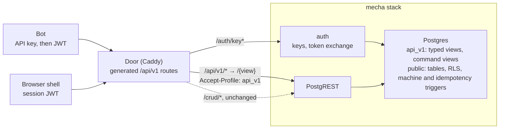

# Pronto App API Export — Design Doc

Design, not built (redesigned 2026-11-11, PRONTO-374; reworked 2026-11-12 to direct view access, no translation code). It replaces the gRPC design of PRONTO-344 (the [first version](https://github.com/bsoneca/pronto-plugins/blob/66aaf80/docs/pronto-api.md), kept in history).

## Summary

We add **pronto-api**, a plugin that exports a pronto app's data and operations as a REST/JSON API. It is **PostgREST served over typed views, with no translation code**: the plugin generates a Postgres schema per major version, `api_v1`, that holds one typed view per exported resource (the public shape: explicit column types, public names and computed fields) and, for a machine, one command view that takes events as inserts. The door maps Google-style URLs straight onto those views through the PostgREST every app already runs: `GET /api/v1/matches/{match}` is a filtered singular read of the `match` view, a `List` is a keyset read ordered by `name`, and `POST /api/v1/matches/{match}:move` is an insert into the command view. There are no per-method SQL functions. The surface follows [Google's API design guide](https://docs.cloud.google.com/apis/design) for resource names, standard and custom methods and the major version in the path, while **errors and pagination keep PostgREST's own shapes in v1** (the owner, 2026-11-12), with Google's shapes as a later option.

There is no gRPC, Connect, protobuf or buf, and no new service. The API is views, a few triggers and a block of door routes, all generated from one author-edited file, `api_spec.cue`, and the app's `program.cue`. It is accepted when two bots holding API keys play complete Bonk Chess matches over it, and the same plugin installed on guestbook works with no chess-specific code.

Postgres stays the only authority. Views are `security_invoker`, and writes go through auto-updatable views to the app's tables, so RLS, CEL checks (CHECK constraints) and machine guards judge every call as the caller: an API client can do exactly what the same user can do in the browser, and nothing more.

One piece still needs SQL, and the doc says so rather than hiding it: a machine's command and open views are written through an INSTEAD OF INSERT trigger (v1, PRONTO-314), which builds the machine's row from the door's headers and the body, lets the machine judge it as it does a browser's, and answers its outcome in the same call. Idempotency is the machine's own: the command id carries `request_id`.

**What changed from the gRPC design, and why**

| Before (PRONTO-344) | Now | Why |
| --- | --- | --- |
| A Deno `api` service (connect-es) transcoding gRPC, Connect and REST to `/crud` | No service and no per-method code: the door rewrites each route to a read or write on an `api_v1` view | A service, then functions, only translated names and errors; reading and writing the typed views is already what PostgREST does |
| CUE → `.proto` → descriptor set, `fields.lock.cue`, `buf breaking` | CUE → `api_v1` SQL, door routes, `openapi.json`, `contract.json` | No wire format to number; the contract is the JSON shape, guarded by a contract diff and by Postgres itself |
| Machine command = insert, then a second request to read the result back | An insert into the command view, whose INSTEAD OF trigger inserts the machine's command, reads back what the machine's AFTER trigger stamped, and answers it | The machine runs unchanged for the browser; a BEFORE-trigger machine (PRONTO-392) would let a plain insert answer too |
| Google errors (AIP-193) and opaque `page_token` | PostgREST's statuses and bodies, and a plain `name` cursor, in v1 | Nothing translates, so nothing to maintain (the owner, 2026-11-12); Google's shapes stay a later option |
| `Watch` (server stream) and a 25 s long-poll | Clients poll `Get` | A long-poll holds a PostgREST pool connection; chess bots need no more than one read a second |
| Native gRPC over HTTP/2 end to end on Cloud Run (h2c into Deno 2.9) | Plain HTTP through the door, as the shell's `/crud` | Nothing new on the wire |

**Goals**

1. One install command (`pronto-api <app>`) and one author-edited file (`api_spec.cue`) export an app. The `api_v1` SQL, the door routes and `openapi.json` are generated, never hand-written.
2. The REST surface reads like a Google API: resource-oriented names, standard and custom methods, and stable for the life of `v1`. Errors and pagination follow PostgREST in v1.
3. Bots get a durable identity: per-account API keys, exchanged for short-lived user tokens, never the service role.
4. Mecha machines are exported generically: each machine named in the spec becomes a resource with `Create`, `Get`, `List` and one custom method per exported event.
5. Validation is data: a CUE scenario plays Bonk Chess games end to end over the API in the gate, with the `http` step the runner already has.

**Non-goals:** a public developer program, OAuth for third-party apps, webhooks, push (watch or streaming) in `v1`, PostgREST's own query grammar as a public contract, an MCP server (it can be generated from `openapi.json` later), and exporting `tab`/`device` entities that have no server table.

## Context: how a pronto app talks to its server today

A pronto app has no RPC layer and no per-app HTTP routes: every write is a keyed row change to PostgREST, and every server rule is a Postgres constraint, RLS policy or trigger-backed state machine. That is the seam this design uses: the API is a second, stable PostgREST schema over the tables the app already has, not a second backend.

| Concern | How it works today | Where |
| --- | --- | --- |
| Program | `program.cue` declares `pronto.#App` with `state.entities` (fields, CEL checks, `durability`, `access`); SQL, HTML and JS are generated from it | `apps/*/program.cue` |
| Writes | Optimistic local write, IndexedDB outbox, then `POST/PATCH/DELETE /crud/<table>`; the door adds `Prefer: resolution=ignore-duplicates`, so a replayed POST is a no-op | `apps/*/docker/Caddyfile`, omnishell `docs/data.md` |
| Commands | Gestures are rows with deterministic ids (Bonk Chess `_command`, `Intent`: same click twice = one row); triggers advance state machines and raise on illegal transitions | `apps/brawl-chess/surface.cue`, `machines/*.js` |
| Functions | SQL functions reachable as `/crud/rpc/<fn>` | billing `service.ts` |
| Reads | `server` entities via `/crud/<table>?…` (PostgREST grammar); `live` entities via Electric shapes at `/electric/*`, gated by `/auth/shape` tokens | mecha `ARCHITECTURE.md` |
| Identity | HS256 JWT `{role, sub, handle, exp, guest?}`; `POST /auth/guest` mints a guest, passkeys promote it; sidecars use a pre-signed `service` token (`SERVICE_JWT`) | mecha `services/auth` |
| Plugins | Installer `bin/pronto-<name> <app>` writes `<name>_plugin.cue` (generated), `<name>_spec.cue` (author-edited), migrations, hatches and sidecars | `bsoneca/pronto-plugins` |
| Gates | `generate`, `lint`, `test`, `integrate@local`; scenarios are CUE with Playwright actors and an `http` step that already calls `/crud` as an actor | `tests/scenarios/schema.cue` |

What is missing for an external client: a stable contract (raw `/crud` exposes table names and RLS internals that change with migrations), a durable identity for a non-browser client (no API keys), a discoverable list of what may be called, and errors a client can branch on. PostgREST can serve all of that once it is pointed at a schema made for the API instead of at the app's tables.

## Design



Three layers, each generated from `api_spec.cue` and `program.cue`:

1. **Views** (`api_v1.<resource>`). One per exported resource: the columns the API shows, renamed to public field names, plus the standard fields `name`, `create_time`, `update_time` and `etag`. A view is `security_invoker` over the app's tables, so RLS on the tables still filters what the caller sees. It is the only place an internal table or column name meets a public one. A machine also gets a command view (`api_v1.match_command`), whose columns are the event's public fields.
2. **Methods** (reads and writes on those views, no functions). `Get` and `List` are reads of the view. `Create`, `Update` and `Delete` are writes through the view: a simple view over one table is auto-updatable, so Postgres maps the public columns back to the table's columns, and RLS and CHECK constraints judge the write as now. A machine event is an insert into its command view.
3. **Routes** (a generated door hatch). Each Google route, a verb plus a path template, is rewritten to one PostgREST call on a view, with `Accept-Profile`/`Content-Profile: api_v1`:
   - `GET /api/v1/matches/{id}` becomes `GET /match?name=eq.matches/{id}` with `Accept: application/vnd.pgrst.object+json`, a filtered singular read.
   - `GET /api/v1/matches?page_size=&after=` becomes `GET /match?order=name.asc&limit=<page_size>&name=gt.<after>`, a keyset read; a nested list adds `name=like.players/{player}/games/*`.
   - `POST`, `PATCH` and `DELETE` become the same verb on the view (`PATCH` and `DELETE` filtered by `name=eq.…`), with `Prefer: return=representation`.
   - `POST /api/v1/matches/{id}:move` becomes `POST /match_command`, and the door passes the resource name and the event in `X-Api-Name` and `X-Api-Event`, since Caddy does not edit a JSON body (the command table's BEFORE trigger, below, fills them in).

   The door builds the whole PostgREST query from the route and the query parameters the route declares (`page_size`, `after`, and an `If-Match` header turned into `etag=eq.…`), and drops everything else, including any `Prefer` header from the client, so no PostgREST grammar (`select=`, `or=`, embeds) reaches PostgREST from a client. `page_size` is passed only when it matches 1 to 200, else the default is 50. A path not generated is `404` at the door; the raw views are never routed under `/api` by their own name, and the `/crud` block strips `Accept-Profile` and `Content-Profile`, so `/crud` cannot reach `api_v1` either.

### Why views, with no functions

An earlier version of this design served every method through an `api_v1.<method>` function that translated requests, outcomes and errors. We use the views directly instead (the owner: "I wanted this to be more transparent, no code to translate."), because:

- **Nothing to read between the route and the row.** A `Get` is a `SELECT` on the view, a `Create` an `INSERT`. What the client sends is what Postgres runs, and what Postgres raises is what the client sees, so a bug has one place to be.
- **The database already does the work.** Auto-updatable views map public columns back to table columns, RLS and CHECKs judge writes as the caller, and PostgREST already turns a raised error into a status and a body.
- **The query grammar stays private.** The door builds the query; clients never send `select=`, `or=` or embeds, so the internal tables can change without a client noticing, and only the views' columns are contract.
- **The price is the shapes.** PostgREST answers `406` for an empty singular read where Google says `404`, a list is a JSON array with no token, and an error body has PostgREST's four fields. We accept that in v1 (Errors and Pagination, below), and the door may still rewrite status codes.

What this costs in SQL, stated plainly: one generated trigger function per machine view. The machine writes `outcome`, `reason` and `revision` in an AFTER INSERT trigger's UPDATE, which `INSERT … RETURNING` on its table does not show; so the command view is not auto-updatable but has an INSTEAD OF INSERT trigger that inserts into the command table (the machine's trigger fires in the same transaction), reads the stamped row back and returns it as the view's row. **Idempotency** needs nothing new: the command id is `{room}/{etag}/{seat}/{event}/{request_id}`, so a retry finds its stored row.

Views stay because they keep the contract and the internals apart: a migration that renames a table changes a view's body, not its columns, and Postgres refuses `CREATE OR REPLACE VIEW` that drops, renames or retypes a column, which is the first guard of `v1`'s stability.

Views are plain views, computed on read. A view materialized into a table (kept by triggers or CDC) is a later option for a read too slow as a view; nothing in `v1` needs one.

### Views have a strong schema

A view is the API's contract, so its shape is declared, never inferred from the tables under it (the owner, 2026-11-11: "this view must have strong schema (for api evolution)"):

- **Every column has the type `program.cue` gives its field**, and `contract.json` records it. A public field stays a plain column reference, because a cast makes a view column read-only and the view would no longer be auto-updatable; so retyping the table column retypes the view, and the additive-only check against `released.json` fails it. Read-only stamps (`create_time`, `update_time`) are cast to `timestamptz`. Writes are granted column by column: only the public fields, never a stamp, and never the key for `UPDATE`, so writing either is `42501` (built in PRONTO-324).
- **Enums are Postgres types** (with machines, PRONTO-314). Each enum field is a Postgres enum in `api_v1` with the UPPER_SNAKE values the spec lists (`api_v1.match_phase`: `WAITING`, `PLAYING`, `FINISHED`). The view maps the table's value into it, so an unmapped internal value fails the cast instead of leaking.
- **Nullability is contract.** Postgres does not keep `NOT NULL` on view columns, so `contract.json` records each field's type and whether it may be null, and each column that must not be null is wrapped so a null raises. The additive-only check fails when a field is removed, retyped, renamed, or becomes nullable.
- **Postgres is the backstop.** `CREATE OR REPLACE VIEW` refuses to drop, rename or retype a column, so a migration that would break a view fails `integrate@local` (Versioning, below).

### What the installer writes

Following the existing plugin shape (billing, flags, analytics):

| File | Owner | Holds |
| --- | --- | --- |
| `api_plugin.cue` | generated, do not edit | The `#Api` schema the spec is checked against |
| `api_spec.cue` | app author | Which entities and machines are exported, their public names and fields; the only hand-written input |
| `api/v1/api_v1.sql` | generated by `generate` | Schema `api_v1`: the typed views and (PRONTO-314) each machine's seat, public, command and open views, no method functions; schema `api_private`, not exposed: the flag's gate and the command and open views' INSTEAD OF INSERT trigger functions (the room's name and the event from the door's headers); grants to `app_user`. Idempotent (`CREATE OR REPLACE VIEW`), so the app lists it among its raw migrations and every release replays it, as `flags/flags.sql`; committed, so `guard-generated` catches drift |
| `api_door.cue` | generated | `apiDoor`: the routes; the Caddyfile block, a `handle /api/v1/*` beside the door's `/crud` one, with one rewrite per route onto a view (filters, order and limit built from the path and the declared query parameters), `Accept-Profile`/`Content-Profile: api_v1`, and the client's query, `Prefer` and profile headers dropped; and `crudStrips`, the headers the `/crud` block drops. the route step (`api/generate.ts route`) puts it in the door, always; the flag is the views' gate, per request (PRONTO-325) |
| `api/v1/openapi.json` | generated | OpenAPI 3.1 for the Google routes, with PostgREST's error body (not PostgREST's own `/` document, which describes the views by table name) |
| `api/v1/contract.json` | generated | Every route, field and type, sorted; the additive-only check compares it with `released.json` |
| mecha `cluster.cue` option | installer | PostgREST's schemas become `public,api_v1` (`PGRST_DB_SCHEMAS`, a mecha-fork option, PRONTO-376; today `PGRST_DB_SCHEMA` is fixed to `public` for every app), so `/crud` keeps `public` as its default and is unchanged |
| `flags_spec.cue` entry | installer | Flag `api_export`: `default: false`, `local: true`; off for an account, every view is empty to it and refuses its writes (`api_private.api_on`), and its keys are refused |

### The spec

An author names what to export and its public names; types, checks and access are read from `program.cue`, so nothing is restated:

```cue
api: {
  version: "v1"
  // a mecha machine: public collection -> its reducer (program.cue's state.mecha.reducers); its
  // surface tables are <machine>_seat, _command, _open and _public, checked against program.cue
  machines: matches: {
    machine: "chess_match"
    opens:  ["create", "join"]                // Create (POST /matches?match_id=) and :join, each a port the machine has
    events: ["move", "resign", "offer_draw", "accept_draw", "decline_draw"]  // custom methods :move, :resign, :offerDraw, …; each tier omnishell
    public: { white_name: "white_name", clock: "clock" }  // the List, over the public table
  }
  // plain entities: public collection -> table, its fields, and which methods
  entities: players: { table: "player_card", fields: { display_name: "handle", rating: "rating" }, methods: ["get"] }
  entities: games:   { table: "player_game", parent: { collection: "players", field: "player_id" }, fields: { result: "result", reason: "reason", match: "room" }, methods: ["get", "list"] }
}
```

A spec that names a field the entity lacks, an event the machine does not declare or keeps server-only, an open kind its ports lack, or a write on an entity whose access forbids it fails `generate`. Exporting is opt-in per method; nothing is public by default. A custom method backed by an app SQL function is not in `v1`: it is the one case where a function would be the right tool, and nothing needs it yet.

### Resources and methods (Google API design guide → PostgREST views)

**Resource names** (AIP-122). Every view has a `name` column, `{collection}/{id}`, nested under a parent where the spec says so: `matches/{match}`, `players/{player}`, `players/{player}/games/{game}`. Collections are plural lowerCamelCase (`matches`, `players`); ids are the row's existing key, never a new one.

**Standard methods** (AIP-131 to 135) and **custom methods** (AIP-136):

| Method | HTTP | What the door sends PostgREST | Postgres does |
| --- | --- | --- | --- |
| `Get` | `GET /api/v1/{name=matches/*}` | `GET /match?name=eq.{name}`, singular | one filtered read; no row, or one RLS hides, is `406` |
| `List` | `GET /api/v1/{parent}/games?page_size=&after=` | `GET /game?order=name.asc&limit=&name=gt.{after}` | keyset read by `name`, `page_size` default 50, max 200; a JSON array |
| `Create` | `POST /api/v1/matches` | `POST /match`, `Prefer: return=representation` | insert through the view with the client-chosen `id` (AIP-133's user-specified id; `name` is computed from it), or the table's default; an existing one is `409` |
| `Update` | `PATCH /api/v1/{name}` | `PATCH /match?name=eq.{name}[&etag=eq.{If-Match}]` | update the fields in the body; the fields sent are the mask |
| `Delete` | `DELETE /api/v1/{name}` | `DELETE /match?name=eq.{name}` | delete through the view; `204` |
| custom | `POST /api/v1/{name}:verb` | `POST /match_command` | a machine event, an insert into the command view (Machines, below) |

Request fields come from the JSON body; the resource name and the declared query parameters become the filters the door builds. A write that matches no row, because the name is wrong, RLS hides it, or a stale `etag` was sent in `If-Match`, answers `406` on a singular write, the same as a missing `Get`; the client re-reads to tell them apart.

**Naming** (AIP-140, AIP-142). Fields are lower_snake_case and timestamps end in `_time` (`create_time`), as in Google's proto definitions. JSON keeps snake_case rather than proto3 JSON's lowerCamelCase, because there is no proto to map from and every pronto table and client already speaks snake_case. This, the error body's shape (Errors, below) and the `name` cursor (Pagination, below) are the deliberate departures from the guide, the same for every pronto API. Enums are UPPER_SNAKE strings (`PLAYING`, `WHITE`).

### Pagination

`List` returns a JSON array ordered by `name`. A client asks for the next page with `after=<last name it saw>`; a page shorter than `page_size` is the last. There is no `page_token` and no `next_page_token`: the cursor is the `name` itself, which is plain, stable and already unique.

**A v1 choice.** AIP-158's opaque `page_token` and `{items, next_page_token}` response are the later option, if a list needs a cursor that is not a name; it would change the door and the generated contract, not the views. The owner accepted PostgREST's shape for now (2026-11-12).

### Machines

Machines are what make games work, and they are not uniform: in Bonk Chess `chess_presence` has a lease table and no open table, `chess_challenge` has no public table, and each machine has its own protocol `version` and reason set. So the spec names each machine's surface tables explicitly and the generator checks them against `program.cue`; the plugin assumes no naming convention. One mapping then serves any machine:

| Method | HTTP (Bonk Chess) | What the view does |
| --- | --- | --- |
| `Create` | `POST /api/v1/matches?match_id={uuid}` `{input, request_id}` | insert into the open view, kind `create`; the response is the open row with its `outcome` |
| custom open | `POST /api/v1/matches/{match}:join` `{input, request_id}` | insert into the open view, kind `join` |
| `Get` | `GET /api/v1/matches/{match}` | the caller's seat row through the `match` view: `seat`, `phase`, `view` (the machine's whole seat view in v1), `etag` (the seat's revision) |
| `List` | `GET /api/v1/matches` | the public view (waiting rooms), when the machine has one |
| custom event | `POST /api/v1/matches/{match}:move` `{payload: {uci}, etag, request_id}` | insert into the command view; the response is the command row with its `outcome`, `reason` and the room's next `etag` |

A command response is the command row, not the whole `Match`: the client reads `Get` for the board.

The details the code forces:

- **One call answers, through the view (v1).** The machine writes `outcome`, `reason` and `revision` in an AFTER INSERT trigger's UPDATE, invisible to `RETURNING` on its table. The command view's INSTEAD OF INSERT trigger (`api_private.<view>_command`, security invoker) inserts into the command table, where the machine's trigger judges the command in the same transaction, then reads the stamped row back and returns it. Changing the machine to a BEFORE trigger (PRONTO-392) would touch every browser's `/crud` path, so v1 leaves it alone.
- **The command id is built by the trigger,** from the room, the request's `etag` (the revision the client saw), the seat, the event and `request_id`, and `version` comes from the machine's setup; clients never compute either. The room and the event come from the door's `X-Api-Name` and `X-Api-Event` headers, which the block strips from every request first, so a client cannot name another.
- **Retries are the machine's receipt.** The trigger first looks for the caller's command in the room with that `request_id`: the same id and body answer the stored row (same `etag`, nothing written twice); another body is `409`, `idempotency_conflict`. `api_private.request` is not needed.
- **A rejection stores nothing.** The machine stores a rejected command for the browser; the view's trigger raises on it (`stale_revision` as `PT409`, any other reason as `P0001` with the reason in `DETAIL`), so the call rolls back, leaving no row. That is safe: a rejection changes no state, so a retry is judged again on the same state and gets the same rejection.
- **Server-only events have no route.** `start` and the like are not in `events`, so `POST …:start` is `404` at the door and writes nothing.

Clients learn of the other seat's move by polling `Get` (a bot: once a second). `etag` changes on every revision, so a client compares it and does nothing when it has not moved. Push (a watch over the seat's Electric shape) is a later version's, when a client needs it.

### Identity

A bot is an ordinary account with an API key; the API never runs as `service`. Keys live in mecha-fork's auth service (PRONTO-312), so the JWT signing secret stays in one process:

1. A signed-in, non-guest user calls `POST /auth/keys` and gets `pk_live_…` once; auth keeps only its SHA-256 hash, owner, label, scopes and `last_used`.
2. The bot exchanges it at `POST /auth/key` for a user JWT with the usual claims plus `kid` (key id) and `scp` (scopes), lifetime 15 minutes.
3. Every call carries `Authorization: Bearer <jwt>`; PostgREST verifies it as it does the shell's, so `auth_uid()` is the key's owner and RLS applies unchanged. Scopes are checked once, before the query, in mecha's `app_pre_request`, which already refuses a key token's read without `read` and write without `write` (mecha-fork#37); the same hook checks `machines:{name}` for a command view, from a list the generator writes, and reads `request.jwt.claims`. A session token without `scp` (the browser's) has all of its user's rights.

Keys are off unless the app's mecha config sets `capabilities.apiKeys`, which the installer sets from `api_export`. A key's own token cannot make keys (`403`, reason `key token`).

Guests cannot issue keys, and `app_pre_request` refuses a guest token on every `api_v1` view with `403`, reason `guest`, so no view carries a guest check.

### Errors

**A v1 choice: PostgREST's statuses and bodies, as they are** (the owner, 2026-11-12: "Yes, it is ok for now."). Nothing translates an error into Google's shape. PostgREST answers with a JSON body of four fields and a status from the error's SQLSTATE:

```json
{"code": "P0001", "message": "rejected", "details": "illegal_move", "hint": null}
```

`code` is the SQLSTATE or a `PGRST` code, `message` is the error's message, `details` carries the app's own raised reason unmapped (the machine's `illegal_move`, `not_your_move`, `room_unavailable`, `stale_revision`, so a client sees exactly what a browser would), and `hint` is the database's hint, when there is one. A trigger that needs a particular status raises with a `PTnnn` SQLSTATE (`PT409`), which PostgREST turns into that status.

| When | HTTP | `code` | `details` |
| --- | --- | --- | --- |
| machine rejects a command | 400 | `P0001` | the machine's reason: `illegal_move`, `not_your_move`, `room_unavailable`, … |
| CEL check (CHECK constraint) or malformed field | 400 | `23514`, or `22P02` for a bad value | the constraint and the row, from Postgres |
| `etag` older than the resource, on a command | 409 | `PT409` (message `stale_revision`) | `stale_revision`, the machine's own reason |
| same `request_id`, different body | 409 | `PT409` (message `idempotency_conflict`) | `request_id` |
| no seat in the room, an event or open kind not exported | 404 | `PT404` | |
| `etag` or `request_id` missing or malformed | 400 | `PT400` (message `invalid_argument`) | the field |
| `Create` with a `name` that exists | 409 | `23505` | the key, from Postgres |
| singular read or write that matches no row, or one RLS hides | 406 | `PGRST116` | `The result contains 0 rows`; never says which |
| no, bad or expired token | 401 | `PGRST301` or `PGRST303` | PostgREST's own |
| guest, missing scope | 403 | the hook's own | `guest`, `scope` |
| RLS refusal on write | 403 | `42501` | from Postgres |
| not exported, or an unknown path | 404 | none | the door's own `404`; writes nothing |

The door may still rewrite status codes (for example `406` into `404` for a `Get`, or `201` into `200`); it does so by route, and does not touch bodies. Whatever it does is generated, so the contract lists it. Only `429`, `503` and `504` are retriable, matching the outbox's own rule.

**The later option.** Google's AIP-193 shape (`{"error": {code, message, status, details: [ErrorInfo]}}`, with `NOT_FOUND`, `FAILED_PRECONDITION`, `ABORTED` and the rest) can replace this body later by having the door rewrite PostgREST's error into it. Nothing in the views changes for that; clients that branch on `details` today keep the same reason words.

## Validation: Bonk Chess over the API

The plugin is done when a CUE scenario, `tests/scenarios/api_match.cue`, plays five complete games between two API-key bots in the gate, and every ending, refusal and record matches what the browser path produces. It uses the runner's existing `http` step (`{method, path, body, expect: {status, json}, keep}`), so the runner learns nothing new. The browser is used once, to sign the two accounts up, because only a passkey or the identity stand-in can make a non-guest account.

### One match, call by call

Two accounts, `ada` (white) and `bob` (black), play Fool's mate:

1. Each actor signs up in its page (existing step), then `POST /auth/keys` with its session token and keeps the key, then `POST /auth/key` and keeps the JWT.
2. ada: `POST /api/v1/matches` `{name: "matches/{uuid}", clock: "none"}` → 201, the open row; `GET /api/v1/matches/{uuid}` then shows `phase: WAITING`; keep `name`.
3. bob: `POST /api/v1/{name}:join` → 201.
4. Both: `GET /api/v1/{name}` → `phase: PLAYING`, ada `seat: WHITE`, `etag` e.
5. ada: `POST /api/v1/{name}:move` `{uci: "f2f3", etag: e, request_id: "{uuid}"}` → 201, the command row with `outcome: accepted` and a new `etag`.
6. bob polls `GET /api/v1/{name}` until `etag` moves, plays `e7e5`, and the two alternate `g2g4`, `d8h4`.
7. Both read `phase: FINISHED`, `result: BLACK`, `reason: "checkmate"`; `GET /api/v1/players/{bob}/games` lists the game (a JSON array), and `GET /api/v1/players/{bob}` shows one more win.

### The games

Games are data, in `spec/api_games.cue`, and the scenario is generated from them by a CUE comprehension, so adding a game adds no code. A unit case replays each game through `machines/match.js` and asserts its declared ending, so a typo in a move list fails in `test` before any stack starts.

| Game | Moves (UCI) | Clock | Expected end |
| --- | --- | --- | --- |
| Fool's mate | f2f3 e7e5 g2g4 d8h4 | none | black, checkmate, 4 plies |
| Threefold | g1f3 g8f6 f3g1 f6g8 g1f3 g8f6 f3g1 f6g8 | none | draw, threefold repetition |
| Stalemate (Loyd) | e2e3 a7a5 d1h5 a8a6 h5a5 h7h5 h2h4 a6h6 a5c7 f7f6 c7d7 e8f7 d7b7 d8d3 b7b8 d3h7 b8c8 f7g6 c8e6 | none | draw, stalemate, 19 plies |
| Resign | e2e4, then bob `:resign` | 3+2 | white, resignation |
| Agreement | e2e4 e7e5, ada `:offerDraw`, bob `:acceptDraw` | 5+0 | draw, agreement |

### Refusals the scenario asserts

Each is one `http` step expecting a status and body, taken from the machine's own reasons and from PostgREST's shapes:

| Call | Expect |
| --- | --- |
| bob moves on ada's turn | 400, `code: P0001`, `details: not_your_move` |
| ada plays `e2e5` | 400, `code: P0001`, `details: illegal_move` |
| ada sends an old `etag` | 409, `code: PT409`, `details: stale_revision` |
| ada repeats step 5 with the same `request_id` and body | no second row; `GET` shows the same `etag` and no second move |
| same `request_id`, different body | 409, `code: PT409`, `details: idempotency_conflict` |
| a third account joins the full room | 400, `code: P0001`, `details: room_unavailable` |
| bob gets ada's private resource by name | 406, `code: PGRST116` (RLS hides it) |
| a guest token calls `POST /auth/keys` | 403, `guest` (the auth service's own body) |
| a revoked key calls `POST /auth/key` | 401 (the auth service's own body) |
| `POST …:start` (a server-only event) | 404 from the door, no row written |
| `GET /api/v1/match?id=eq.x` (PostgREST grammar) | 404 from the door |

### Proving it is generic

The same plugin is installed on guestbook, with a spec of a few lines (`entries`: get, list, create), and a three-step scenario creates and lists an entry. The plugin's own lint fails if `pronto-plugins/api/` names any app, table or event; everything app-specific comes from `api_spec.cue` and `program.cue`.

`openapi.json` is the reference for client authors; any OpenAPI generator makes a client from it. A sample bot is `curl` in the README.

## Security, idempotence, limits and versioning

The API's authority is the user's, enforced by the database; the generated SQL only narrows it.

**Security**

- No service role. Views are `security_invoker`, and writes go through auto-updatable views, so every read and write runs as the token's user under the tables' RLS, and the base tables' privileges are checked as that user. There are no `SECURITY DEFINER` functions and no functions to call: a bug in a generated view or trigger can never touch a row its caller could not.
- Allow-list, not deny-list. Only generated routes are mounted under `/api/v1`, and the door builds each query itself; `/rpc` is never routed there, and `/crud` cannot select `api_v1`. `/crud` itself is unchanged: a key token reaches it within its scopes, as the user's session does.
- `api_v1` is granted to `app_user` only (the role every user and key token carries): `USAGE` on the schema, and `SELECT`, `INSERT`, `UPDATE` or `DELETE` on each view for the methods the spec exports, all revoked from `PUBLIC` and `anon`. Refusing guest tokens on `api_v1` is PRONTO-393. A machine view's trigger writes the machine's command or open table as the caller (security invoker), under that table's own RLS.
- Scopes per key: `read` and `write`, checked by `app_pre_request` from the token's `scp`; RLS still checks the row. `machines:{name}` and refusing guests on `api_v1` need a hook in mecha-fork (PRONTO-393), not in v1.
- Keys are shown once, stored as SHA-256, revocable, at most 5 per account; issued tokens expire within 15 minutes.
- Bonk Chess specifics stay where they are: stand-in seating, rating, gold and Premium gates are triggers, so a bot gets exactly what its account would. Bots are marked and their games unrated (PRONTO-316).

**Idempotence** (AIP-155)

- Every machine call takes `request_id` (1 to 36 of `[A-Za-z0-9_-]`, a UUID fits). A machine event maps it into the command row id (`{room}/{etag}/{seat}/{event}/{request_id}`), so a retry is the same row and is not written twice; a `Create` also keeps the client's `name`.
- A reused `request_id` is answered from the machine's own row (its command id carries it), in the same transaction as the effect, so it holds exactly the requests that took effect; with another body it is `409`, `idempotency_conflict`. An open's id is `{room}/{kind}/{request_id}`, the same way.
- Every machine event requires `etag` (AIP-154), which turns a lost race into `409`, reason `stale_revision`, that the client resolves by re-reading the resource.

**Limits**

- `v1` ships with no per-key request limit. The door is stock Caddy (`caddy:2.11.7-alpine`), which has no rate limiting, and a limit cannot live in Postgres: a `GET` runs in a read-only transaction, and a refused request rolls its transaction back with its count.
- What bounds a bot meanwhile: 5 keys per account, 15-minute tokens, PostgREST's connection pool, and the machines' own pace (one move per turn). The door caps `page_size` at 200.
- A limit, when needed, goes before PostgREST: a Caddy build with a rate-limit module, or the edge (Cloudflare) in front of the door. Either answers `429`, `details: rate_limited`, with `Retry-After`.

**Versioning** (AIP-185)

Stability is the reason the API exists: the app's tables change whenever a migration does, while `/api/v1` never changes incompatibly for its whole life. Releases ship every 2 hours, so this is enforced by gates, not by care.

- The major version is in the path and the schema: `/api/v1` is `api_v1`. Within it, changes are additive only: new resources, methods, fields and enum values clients must tolerate. Nothing is removed, renamed or retyped.
- `contract.json` lists every route, field and type (and the status codes the door rewrites). Each release freezes it as `api/v1/released.json`, and `test` fails when the current contract lacks or retypes anything the released one has.
- Postgres guards the views too: `CREATE OR REPLACE VIEW` cannot drop, rename or retype a column, so a migration that would break a view fails `integrate@local`. A dropped table column a view still needs fails `generate`.
- The API scenario runs against the released contract as well as the current one, so behaviour, not only shape, stays compatible.
- A breaking change means `api_v2` and `/api/v2`, generated beside `v1` from a second `version` in `api_spec.cue`; `db-schemas` lists both, and `v1` keeps working for at least 6 months after `v2` ships.
- A deprecated method keeps working and its responses carry `Deprecation` and `Sunset` headers (set by the door) for 30 days before it goes in the next major version.

## Rollout, gates and open questions

Pull requests, each behind the `api_export` flag (`default: false` in production, `local: true`), each passing `generate`, `lint`, `test` and `INTEGRATE_LOCAL_DRIVERS=all ./saytw integrate@local` before automerge:

1. **Keys** (mecha-fork, PRONTO-312, merged as mecha-fork#36 and #37), then **the flag and keys in Bonk Chess** (PRONTO-323). Unchanged by this redesign.
2. **`api_v1` in PostgREST** (mecha-fork, PRONTO-376): a cluster option that adds schemas after `public`, and its pin in Bonk Chess and guestbook.
3. **Plugin core** (pronto-plugins `api/`, PRONTO-324, built; `api/README.md`): the `#Api` schema, the generator for entities (views, grants, door routes, `openapi.json`, `contract.json` and its additive check), with unit cases on PGlite; it removes the gRPC spike (`service.ts`), the proto generator, `api/proto/` and buf from ci.
4. **guestbook** (PRONTO-325): `bin/pronto-api`, installed with a small spec and `api_entry.cue` over `http` steps. The flag gates the views per request, since the door's Caddyfile is static.
5. **Machines** (PRONTO-314, v1 built): the seat, public, command and open views, the INSTEAD OF triggers, `Get`, `List`, Create, `:join` and events, `etag` and `request_id`, on a two-seat stand-in machine on PGlite. Follow-ups: the BEFORE-trigger machine, so a plain insert answers (PRONTO-392), and the `machines:{name}` scope with guest refusal (PRONTO-393).
6. **Bonk Chess** (PRONTO-316, then PRONTO-315): bots marked and unrated; `pronto-api brawl-chess`, `api_spec.cue`, `spec/api_games.cue`, the replay unit case and `api_match.cue`. Release-cron ships it; nothing is released by hand.
7. **On the wire** (PRONTO-320) and **the production tester** (PRONTO-328).

The flag goes live with `pronto-flags push`, which needs a `production` scenario, and a production scenario writes nothing. So it only reads: it exchanges the tester account's key (issued once, kept with the tester's other credentials; the exchange writes only the key's `last_used`), then gets its own player. Games are proven by the local gate and release-cron's rehearsal, never on production.

**Decisions**

- [x] PostgREST over typed views, no service (the owner, 2026-11-11: "The right name is a view. And this view must have strong schema"). Views carry every shape and every method (Design, above).
- [x] Direct view access, no translation code; PostgREST errors and a name cursor in v1 (the owner, 2026-11-12: "I wanted this to be more transparent, no code to translate." and, asked whether errors and pagination may follow PostgREST's shapes, "Yes, it is ok for now."). Idempotency and the one-call command outcome still need SQL, as triggers (Why views, above). Google's AIP-193 errors and AIP-158 tokens are the later option.
- [x] Google's API design guide for resource names, methods and paths; snake_case JSON, PostgREST's errors and the name cursor are the v1 departures.
- [x] No gRPC, Connect, protobuf or buf. The spike's findings (runtime descriptors in connect-es, h2c into Deno 2.9) are no longer needed; its code goes with PRONTO-324.
- [x] Key exchange in mecha-fork's auth service; bots visible as bots; API games unrated; `chess_seek` not in `v1` (the product manager, 2026-11-11).
- [x] No push in `v1`: clients poll `Get` and compare `etag`.

**Open questions**

- [ ] Per-key rate limits: a Caddy build with a rate-limit module, or Cloudflare in front of the door? Not in `v1` (Limits, above); PRONTO-327 was cancelled until a bot needs one.
- [ ] Generate an MCP server from `openapi.json` in `v2`, so agents can play through tools?

**Sources:** the first version's sources (read from the monorepo on 2026-11-10: `AGENTS.md`, `apps/brawl-chess/{program.cue, surface.cue, machines/, tests/scenarios/, standin/}`, mecha `services/auth` and `ARCHITECTURE.md`, pronto `docs/access.md`), the spike (bsoneca/pronto-plugins#200, bsoneca/pronto#1169) and the generator (bsoneca/pronto-plugins#205), [Google's API design guide](https://docs.cloud.google.com/apis/design) and the AIPs it cites (122, 131–136, 140, 142, 154, 155, 185; 158 and 193 for the later pagination and error shapes), and PostgREST's documentation on schemas, views, singular responses and raising errors with `SQLSTATE 'PTnnn'`. The three scripted games were replayed through `machines/match.js` for the first version; the API path has not yet been run.
