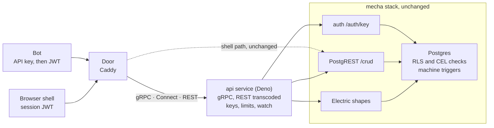

# Pronto App API Export — Design Doc

Design, not built (2026-11-10). Living copy, with its comment threads: [Claude Doc](https://claude.ai/artifact/KjRYUassxrsZnw75wNnAGr).

## Summary

We add **pronto-api**, a plugin that exports any pronto app's operations as a **gRPC** API, defined in CUE and published as a generated `.proto`. The same Deno service also answers REST/JSON at `/api/v1`, gRPC-Web and Connect. REST is transcoded in process through a route table generated from the same CUE, so there is one source, one contract and one handler per method. It is accepted when two bots holding API keys play complete Bonk Chess matches through it, over gRPC and over REST, and the same plugin installed on guestbook works with no chess-specific code.

The plugin adds no new backend logic. Each exported operation is a typed name for something the app already does through `/crud`: insert a row, read rows, call a SQL function, or drive a mecha machine. Postgres RLS, CEL checks and machine guards stay the only authority, so an API caller can do exactly what the same user can do in the browser, and nothing more.

Every call takes one path: client → `api` service (gRPC handler; REST transcoded in the same process) → PostgREST (`/crud`) → Postgres. Two side paths join it: token exchange goes through auth, and watch goes through Electric. `/crud` is how the API is implemented, not its contract, and the mapping is not 1:1:

- **Entities:** one RPC becomes one `/crud` call. Message, field and filter names come from the `.proto`, and PostgREST's query grammar (`select`, `or`, embeds) is never exposed.
- **Machines:** one RPC becomes several calls. `SendCommand` with a `move` becomes a command insert plus a read-back, and the service fills the row id, protocol version and revision.
- **Errors:** database refusals become gRPC status codes with a stable `ErrorInfo.reason`; REST gets the standard HTTP mapping of the same status.

**Goals**

1. One install command (`pronto-api <app>`) and one author-edited file (`api_spec.cue`) export an app. The `.proto`, its REST bindings and the OpenAPI document are generated, never hand-written.
2. Bots get a durable identity: per-account API keys, exchanged for short-lived user tokens, never the service role.
3. Mecha machines are exported generically: each machine named in the spec becomes a gRPC service with `Open`, `SendCommand`, `GetState`, `Watch` and `ListOpen`.
4. Clients learn of changes without speaking the Electric protocol: a server-streaming `Watch` RPC for gRPC and Connect clients, and a long-poll `GetState` for REST.
5. The contract is stable: `buf breaking` against the last released descriptor set fails the gate on any incompatible change.
6. Validation is data: a CUE scenario plays Bonk Chess games end to end over gRPC, Connect and REST in the gate.

**Non-goals:** a public developer program, OAuth for third-party apps, webhooks, an MCP server (designed to drop in later from the same spec), and exporting `tab`/`device` entities that have no server table.

## Context: how a pronto app talks to its server today

A pronto app has no RPC layer and no per-app HTTP routes: every write is a keyed row change to PostgREST, and every server rule is a Postgres constraint, RLS policy or trigger-backed state machine. That is the seam this design uses: the API is a typed, documented, authenticated front for the row grammar the app already speaks, not a second backend.

| Concern | How it works today | Where |
| --- | --- | --- |
| Program | `program.cue` declares `pronto.#App` with `state.entities` (fields, CEL checks, `durability`, `access`); SQL, HTML and JS are generated from it | `apps/*/program.cue` |
| Writes | Optimistic local write, IndexedDB outbox, then `POST/PATCH/DELETE /crud/<table>`; the door adds `Prefer: resolution=ignore-duplicates`, so a replayed POST is a no-op | `apps/*/docker/Caddyfile`, omnishell `docs/data.md` |
| Commands | Gestures are rows with deterministic ids (Bonk Chess `_command`, `Intent`: same click twice = one row); triggers advance state machines and raise on illegal transitions | `apps/brawl-chess/surface.cue`, `machines/*.js` |
| Functions | SQL functions reachable as `/crud/rpc/<fn>` | billing `service.ts` |
| Reads | `server` entities via `/crud/<table>?…` (PostgREST grammar); `live` entities via Electric shapes at `/electric/*`, gated by `/auth/shape` tokens | mecha `ARCHITECTURE.md` |
| Realtime | Electric HTTP long-poll; no websockets | mecha |
| Identity | HS256 JWT `{role, sub, handle, exp, guest?}`; `POST /auth/guest` mints a guest, passkeys promote it; sidecars use a pre-signed `service` token (`SERVICE_JWT`) | mecha `services/auth` |
| Refusals | Any 4xx except 408/429 is non-retriable and surfaces as `refused` | omnishell `docs/data.md` |
| Plugins | Installer `bin/pronto-<name> <app>` writes `<name>_plugin.cue` (generated), `<name>_spec.cue` (author-edited), migrations, hatches and sidecars; sidecars get `CRUD_URL` + `SERVICE_JWT` and are routed by the door | `bsoneca/pronto-plugins` |
| Gates | `generate`, `lint`, `test`, `integrate@local`; scenarios are CUE with Playwright actors and an `http` step that already calls `/crud` as an actor | `tests/scenarios/schema.cue` |

What is missing for an external client: a stable contract (raw `/crud` exposes table names and RLS internals that change with migrations), a way for a non-browser client to get a durable identity (no API keys; the only credential is a 7-day session JWT minted by a passkey, Google sign-in or the guest flow), a discoverable list of what may be called, and a push channel a bot can consume without speaking the Electric shape protocol. PostgREST could emit OpenAPI from the catalog, but no app exposes it, and it would document tables, not operations.

## Design

The plugin is a stateless gRPC service, `api`, plus two tables and one generated contract. It is written in Deno, like every other pronto sidecar, on [connect-es](https://connectrpc.com/docs/web/getting-started), which serves gRPC, gRPC-Web and Connect from one handler per method. REST is a thin layer in the same process: it matches a request against the generated route table, builds the request message from path, query and body, calls that same handler, and maps the status to HTTP. No Envoy, grpc-gateway or Go sits in front. Each handler turns the call into the `/crud` request the browser would have sent, with the caller's own user token, so RLS and machine guards decide every outcome.



The service is the only new box: it holds no authority of its own, and the database decides every outcome for both paths.

### What the installer writes

Following the existing plugin shape (billing, flags, analytics):

| File | Owner | Holds |
| --- | --- | --- |
| `api_plugin.cue` | generated, do not edit | The `#Api` schema the spec is checked against |
| `api_spec.cue` | app author | Which entities, functions and machines are exported, and their public names; the only hand-written input |
| `api/v1/<app>.proto` | generated by `generate` | The published contract: services, messages, `google.api.http` annotations; committed, so `guard-generated` catches drift |
| `api/v1/routes.json` | generated by `generate` | The REST route table: path template, verb, path/query/body fields, target RPC; emitted from the same CUE as the annotations, so the two cannot disagree |
| `api/v1/fields.lock.cue` | generated, append-only | Every field number ever assigned, so regenerating never renumbers a field |
| `api/v1/descriptor.binpb` | generated by `buf build` | The descriptor set the service loads at start |
| `api/v1/openapi.json` | generated from the `.proto` | REST documentation only |
| `api_service.cue` | generated | The `api` container hatch, its routes and `PRONTO_UPSTREAM_API` |
| `services/database/migrations/NN_api.sql` | generated | `api_key`, `api_call` tables, RLS, `api_key_issue()` / `api_key_revoke()` |
| `flags_spec.cue` entry | installer | Flag `api_export`: `default: false`, `local: true` |

The service lives once in `pronto-plugins/api/` and is copied unchanged into each app, like `tests/slot.ts`. At start it loads the app's `descriptor.binpb` into a protobuf-es v2 registry and `routes.json`, and serves those services with messages built from the descriptors, so no per-app code is compiled. The REST layer only handles the four route shapes the generator emits (Operation kinds, below), not all of `google.api.http`. Routing: the door sends `/api/*` and `/<package>.<Service>/*` to it, which covers REST, Connect and gRPC-Web over HTTP/1.1. Native gRPC needs HTTP/2 end to end, so on Cloud Run the service also runs `apart` with HTTP/2 enabled at its own host, `api.<app domain>`, and Deno must accept the unencrypted HTTP/2 (h2c) Cloud Run sends.

### The spec

An author names what to export; the generator reads field types, CEL checks and access from `program.cue`, so nothing is restated:

```cue
api: {
  version: "v1"
  // a mecha machine: public name -> its surface tables, checked against program.cue
  machines: match: {
    machine: "chess_match"
    tables: { open: "chess_match_open", command: "chess_match_command", seat: "chess_match_seat", public: "chess_match_public" }
    open:   ["create", "join"]
    events: ["move", "resign", "offer_draw", "accept_draw", "decline_draw"]
    state:  { fen: "view.fen", moves: "view.moves", result: "view.result", reason: "view.reason", actions: "view.actions" }
  }
  // plain entities: public name -> table, read and, where access allows, write
  entities: player: { table: "player_card", read: { filter: ["id"] } }
  entities: games:  { table: "player_game", read: { filter: ["owner_id", "room"] } }
  functions: {}
}
```

A spec that names a field the entity lacks, an event the machine does not declare, or a write on an entity whose access forbids it fails `generate`. Exporting is opt-in per operation; nothing is public by default.

### The contract: generated proto

`generate` turns the spec and `program.cue` into one `.proto` per app. Machine events become a typed `oneof`, field types and CEL checks come from the entity, and REST paths come from the spec's public names. For Bonk Chess, abridged:

```proto
syntax = "proto3";
package bonk.v1;
import "google/api/annotations.proto";

service MatchService {
  rpc Open(OpenMatchRequest) returns (OpenMatchResponse) {
    option (google.api.http) = { post: "/api/v1/matches" body: "*" };
  }
  rpc SendCommand(SendCommandRequest) returns (SendCommandResponse) {
    option (google.api.http) = { post: "/api/v1/matches/{match_id}/commands" body: "*" };
  }
  rpc GetState(GetStateRequest) returns (MatchState) {
    option (google.api.http) = { get: "/api/v1/matches/{match_id}" };  // ?after_revision= long-polls
  }
  rpc Watch(WatchRequest) returns (stream MatchState);               // gRPC and Connect only
  rpc ListOpen(ListOpenRequest) returns (ListOpenResponse) {
    option (google.api.http) = { get: "/api/v1/matches" };
  }
}

message SendCommandRequest {
  string match_id = 1;
  int64 expected_revision = 2;
  string request_id = 3;  // idempotency key, AIP-155
  oneof event {
    Move move = 10;
    Resign resign = 11;
    OfferDraw offer_draw = 12;
    AcceptDraw accept_draw = 13;
    DeclineDraw decline_draw = 14;
  }
}
message Move { string uci = 1; }  // "e2e4", promotion "e7e8q"
```

Field numbers are taken from `fields.lock.cue`, never from position, so reordering or renaming in CUE cannot renumber the wire format.

### Operation kinds

Four kinds cover every app in the monorepo, because they are the four things `/crud` already does. Each kind has a fixed RPC shape and a fixed REST binding:

| Kind | RPCs | REST binding | Becomes |
| --- | --- | --- | --- |
| Entity read | `Get{E}`, `List{E}s` | `GET /api/v1/{es}/{id}`, `GET /api/v1/{es}?{filter}` | `GET /crud/{table}?{col}=eq.{v}&select=…` |
| Entity write | `Create{E}`, `Update{E}`, `Delete{E}` | `POST`, `PATCH`, `DELETE /api/v1/{es}/{id}` | the same verb on `/crud/{table}`, client id kept |
| Function | `{Fn}` | `POST /api/v1/fn/{fn}` | `POST /crud/rpc/{fn}` |
| Machine | `Open`, `SendCommand`, `GetState`, `Watch`, `ListOpen` | see below | rows on the machine's surface tables |

Machines are what make games work, and they are not uniform: in Bonk Chess `chess_presence` has a lease table and no open table, `chess_challenge` has no public table, and each machine has its own protocol `version` and reason set. So the spec names each machine's surface tables explicitly, and the generator checks them against `program.cue`; the plugin assumes no naming convention. One mapping then serves any machine:

| RPC | REST binding | Row written or read |
| --- | --- | --- |
| `Open` | `POST /api/v1/{ms}` | insert the open table with a client-minted `instance_id`; returns `outcome`, `reason` |
| `SendCommand` | `POST /api/v1/{ms}/{id}/commands` | insert the command table, then read the row back; returns `outcome`, `reason`, `revision` |
| `GetState` | `GET /api/v1/{ms}/{id}` | the caller's seat row: `seat`, `revision`, `phase`, the exported `view` fields; with `after_revision`, holds up to 25 s until the revision passes it |
| `Watch` | none (server stream) | streams the seat row on every new revision |
| `ListOpen` | `GET /api/v1/{ms}` | the public table (waiting tables, open seeks), when the machine has one |

Three details the code forces:

- **Command results are read back.** The machine writes `outcome`, `reason` and `revision` with an AFTER INSERT trigger's UPDATE, which `INSERT … RETURNING` does not show. The service inserts the command, then reads the row by id in the same RPC, and answers with the stored result.
- **The service builds the command id** from the room, the seat's current revision, the seat, the event and the request's `request_id`, and fills `version` from the machine's setup. Clients never compute either, which also keeps the scenario free of arithmetic its steps cannot do.
- **Watch and long-poll share one upstream.** They use keyed Electric shapes when the seat table is keyed or scoped; shape tokens last 900 s, so the service re-mints them and retries on 401. Where a table is neither, the service polls `/crud` once a second. REST has no server streaming through the transcoder, so REST clients use `GetState` with `after_revision`.

### Identity

A bot is an ordinary account with an API key; the API never runs as `service`.

1. A signed-in, non-guest user calls `KeyService.CreateKey` (REST `POST /api/v1/keys`), or a settings screen, and gets `pk_live_…` once; the table keeps only its SHA-256 hash, owner, label, scopes and `last_used`.
2. The bot exchanges it with `KeyService.ExchangeKey` (REST `POST /api/v1/token`) for a user JWT with the usual claims plus `kid` (key id) and `scp` (scopes), lifetime 15 minutes.
3. Every RPC carries, as gRPC metadata or an HTTP header, `Authorization: Bearer <jwt>`; the service forwards it to `/crud`, so `auth_uid()` is the key's owner and RLS applies unchanged.

Key exchange lives in the mecha auth service (a `/auth/key` endpoint in mecha-fork), not in the `api` service, so the JWT signing secret stays in one process. Guests cannot issue keys: a guest is refused every online operation anyway, and keys would let them persist.

### Errors

Refusals become gRPC status codes, and the app's own reason word rides in `google.rpc.ErrorInfo.reason` (domain `pronto.api`), so a client sees exactly what a browser would. REST receives the same status as JSON with the standard HTTP mapping:

| When | gRPC status | REST | `ErrorInfo.reason` |
| --- | --- | --- | --- |
| `outcome: accepted` | `OK` | 200 | none |
| machine `outcome: rejected` | `FAILED_PRECONDITION` | 400 | the machine's reason: `illegal_move`, `not_your_move`, `room_unavailable`, … |
| CEL check or malformed field | `INVALID_ARGUMENT` | 400 | `invalid_field`, with the field in `metadata` |
| `stale_revision` | `ABORTED` | 409 | `stale_revision` |
| same `request_id`, different body | `ALREADY_EXISTS` | 409 | `idempotency_conflict` |
| no or expired token | `UNAUTHENTICATED` | 401 | `unauthenticated` |
| RLS refusal, guest, missing scope | `PERMISSION_DENIED` | 403 | `forbidden`, `guest`, `scope` |
| not exported, or not visible to this caller | `NOT_FOUND` | 404 | `not_found` (never reveals which) |
| per-key rate limit | `RESOURCE_EXHAUSTED` | 429 | `rate_limited`, with `RetryInfo` |

Only `UNAVAILABLE`, `RESOURCE_EXHAUSTED` and `DEADLINE_EXCEEDED` are retriable, matching the outbox's own rule (408, 429 and 5xx).

## Validation: Bonk Chess over the API

The plugin is done when a CUE scenario, `tests/scenarios/api_match.cue`, plays five complete games between two API-key bots in the gate, spread over gRPC, Connect and REST, and every ending, refusal and record matches what the browser path produces. No browser touches the board. The browser is used once, to sign the two accounts up, because only a passkey or the identity stand-in can make a non-guest account.

The scenario schema gains one step kind, `grpc: {service, method, body, expect: {code, reason, json}, keep}`, beside the existing `http` step. The runner (`tests/scenarios.ts`) sends it with a Connect client built from the app's `descriptor.binpb`, over native gRPC (HTTP/2) or the Connect protocol, as the step says. Tests stay data; only the runner learns the new step.

### One match, call by call

Two accounts, `ada` (white) and `bob` (black), play Fool's mate:

1. Each actor signs up in its page (existing scenario step), then calls `KeyService.CreateKey` with its session token and keeps the key, then `KeyService.ExchangeKey` and keeps the JWT.
2. ada: `MatchService.Open` `{instance_id: "{uuid}", kind: CREATE, clock: "none"}` → `OK`, `outcome: accepted`; keep the match id.
3. bob: `MatchService.Open` `{instance_id: match, kind: JOIN}` → `OK`, `accepted`.
4. Both: `MatchService.GetState` `{match_id}` → `phase: PLAYING`, ada `seat: WHITE`, `revision` r.
5. ada: `MatchService.SendCommand` `{match_id, expected_revision: r, request_id: "ada-1", move: {uci: "f2f3"}}` → `OK`, `accepted`, revision r+1.
6. bob: `MatchService.Watch` `{match_id, after_revision: r}` yields as soon as ada's move lands; bob plays `e7e5`, and the two alternate `g2g4`, `d8h4`.
7. Both read `phase: FINISHED`, `result: BLACK`, `reason: "checkmate"`; `PlayerGameService.ListPlayerGames` `{match_id}` shows two rows, and bob's `Player` shows one more win.

The same steps over REST are `POST /api/v1/matches`, `GET /api/v1/matches/{id}`, `POST /api/v1/matches/{id}/commands` and `GET …?after_revision=r` for step 6.

### The games

Games are data, in `spec/api_games.cue`, and the scenario is generated from them by a CUE comprehension, so adding a game adds no code. A unit case replays each game through `machines/match.js` and asserts its declared ending, so a typo in a move list fails in `test` before any stack starts.

| Game | Transport | Moves (UCI) | Clock | Expected end |
| --- | --- | --- | --- | --- |
| Fool's mate | gRPC | f2f3 e7e5 g2g4 d8h4 | none | black, checkmate, 4 plies |
| Threefold | Connect | g1f3 g8f6 f3g1 f6g8 g1f3 g8f6 f3g1 f6g8 | none | draw, threefold repetition |
| Stalemate (Loyd) | REST | e2e3 a7a5 d1h5 a8a6 h5a5 h7h5 h2h4 a6h6 a5c7 f7f6 c7d7 e8f7 d7b7 d8d3 b7b8 d3h7 b8c8 f7g6 c8e6 | none | draw, stalemate, 19 plies |
| Resign | gRPC | e2e4, then bob `resign` | 3+2 | white, resignation |
| Agreement | REST | e2e4 e7e5, ada `offer_draw`, bob `accept_draw` | 5+0 | draw, agreement |

### Refusals the scenario asserts

Each is one `grpc` step expecting a status and `ErrorInfo.reason`, taken from the machine's own reasons. The four marked REST are sent as `http` steps too, checking the transcoded status and the same reason:

| Call | Expect |
| --- | --- |
| bob moves on ada's turn (also REST) | `FAILED_PRECONDITION` / 400, `not_your_move` |
| ada plays `e2e5` (also REST) | `FAILED_PRECONDITION` / 400, `illegal_move` |
| ada sends an old `expected_revision` (also REST) | `ABORTED` / 409, `stale_revision` |
| ada repeats step 5 with the same `request_id` and body | `OK`, same `revision`, no second move |
| same `request_id`, different body | `ALREADY_EXISTS`, `idempotency_conflict` |
| a third account joins the full room | `FAILED_PRECONDITION`, `room_unavailable` |
| bob reads ada's seat by id | `NOT_FOUND` (RLS hides it) |
| a guest token calls `CreateKey` (also REST) | `PERMISSION_DENIED` / 403, `guest` |
| a revoked key calls `ExchangeKey` | `UNAUTHENTICATED` |
| `SendCommand` with a server-only event (`start`) | `INVALID_ARGUMENT`: not in the `oneof`, refused before any row is written |

### Proving it is generic

The same plugin is installed on guestbook in the same pull request, with a spec of four lines (read and write `entry`), and a three-step scenario creates and lists an entry, once over gRPC and once over REST. The plugin's own lint fails if `pronto-plugins/api/` names any app, table or event; everything app-specific comes from `api_spec.cue`, `program.cue` and the generated descriptor set.

A reference client, `pronto-plugins/api/examples/bot/`, uses a client generated by `buf generate` from the app's `.proto` and plays random moves from `view.actions` against a local stack, for anyone who wants to watch two bots play to the end. It documents the API; it is not a gate.

## Security, idempotence, limits and versioning

The API's authority is the user's, enforced by the database; the service only narrows it.

**Security**

- No service role. The service holds no `SERVICE_JWT` for caller traffic; it reads `api_key` only through `SECURITY DEFINER` functions that return a key's owner and scopes by hash. A bug in the service can therefore never write a row the caller could not.
- Allow-list, not deny-list. A path not generated from `api_spec.cue` is `NOT_FOUND` before any upstream call; raw `/crud` stays reachable only by the shell's own token, as today.
- Scopes per key: `read`, `write`, `machines:{name}`. The token carries `scp`; the service refuses an operation outside it with `PERMISSION_DENIED`, and RLS still checks the row.
- Keys are shown once, stored as SHA-256, revocable, and listed with `last_used`; at most 5 per account. Revoking one ends its next token exchange; issued tokens expire within 15 minutes.
- `api_call` logs key id, operation, status and latency (no bodies) for 30 days, which feeds the existing analytics plugin.
- Bonk Chess specifics stay where they are: stand-in seating, rating, gold and Premium gates are triggers, so a bot gets exactly what its account would.

**Idempotence**

- Entity writes keep the client-minted id the door already de-duplicates (`resolution=ignore-duplicates`).
- Every mutating RPC carries `request_id` (AIP-155), a field rather than a header, so it behaves the same over gRPC, Connect and REST. The service maps it into the command row id (`{room}/{revision}/{seat}/{event}/{request_id}`), so a retry is the same row and returns its stored `outcome` and `revision`. It hashes the request into `api_call`, so a reused `request_id` with a different body is `ALREADY_EXISTS`.
- `expected_revision` is required on every command, which turns a lost race into `ABORTED` that the client resolves by re-reading state.

**Limits**

- Per key: 10 commands/s burst 20, 60 reads/s, 4 open watches. Per account: 20 commands/s across keys. Numbers live in `api_spec.cue`, so an app can tighten them.
- A watch holds at most 25 s and one upstream shape per (seat row, service instance), shared by every watcher of that row.

**Versioning**

Stability is the reason the API exists: `/crud` changes whenever a migration does, while `/api/v1` never changes incompatibly for its whole life. Releases ship every 2 hours, so this is enforced by a gate, not by care.

- Within a major version, changes are additive only: new RPCs, new fields with new numbers, new enum values clients must tolerate. Nothing is removed, renamed, renumbered or retyped.
- Each release's descriptor set is frozen as `api/v1/released.binpb`. The `test` step runs `buf breaking` (rule set `WIRE_JSON`, which guards both the binary and the JSON/REST encoding) against it and fails on any incompatible change, whatever the release cadence.
- `fields.lock.cue` is append-only: a field number, once assigned, is never reused, even after the field is deprecated.
- The API scenario runs against the released contract as well as the current one, so behaviour, not only shape, stays compatible.
- A breaking change means package `bonk.v2` and `/api/v2`, served beside `v1` by the same service. `v1` keeps working through mappings in `api_spec.cue` for at least 6 months after `v2` ships.
- The package and path carry the major version; `api_spec.cue` may declare `v1` and `v2` side by side during a migration.
- `generate` writes the `.proto`, `routes.json`, the descriptor set and, from them, `openapi.json` for REST readers. CUE is the only source; the generated `.proto` is the published contract.
- Public names belong to the spec, not the tables. Each export maps a public message and field to an internal table and column, so a rename in `program.cue` changes the mapping, not the contract; a dropped column an export still needs fails `generate`.
- Deprecations are marked `deprecated = true` in the `.proto`, and REST responses carry `Deprecation` and `Sunset` headers for 30 days before removal in the next major version.

## Rollout, gates and open questions

Five pull requests, each behind the `api_export` flag (`default: false` in production, `local: true`), each passing `generate`, `lint`, `test` and `INTEGRATE_LOCAL_DRIVERS=all ./saytw integrate@local` before automerge.

1. **Spike, 2 days** (pronto-plugins `api/`): a Deno service that loads a descriptor set into a protobuf-es registry and serves one method over native gRPC, Connect and a generated REST route, on Cloud Run with HTTP/2. It settles the two unproven pieces, runtime descriptors in connect-es and h2c into Deno, before any plugin code.
2. **Auth key exchange** (mecha-fork): `/auth/key` mints a 15-minute user JWT from a hashed key; `KeyService` fronts it. Unit cases for expiry, revocation and guest refusal.
3. **Plugin core** (pronto-plugins `api/`): schema, CUE-to-proto and CUE-to-routes generator with `fields.lock.cue`, `buf breaking` in `test`, the service for entities and functions, and the scenario runner's `grpc` step. Installed on guestbook with its scenario.
4. **Machines and watch** (pronto-plugins `api/`): `Open`, `SendCommand`, `GetState`, `Watch`, `ListOpen`, idempotency, status mapping, rate limits.
5. **Bonk Chess** (apps/brawl-chess): `pronto-api brawl-chess`, `api_spec.cue`, `spec/api_games.cue`, the replay unit case and `api_match.cue`. Release-cron ships it; nothing is released by hand.

The flag goes live with `pronto-flags push`, which needs a `production` scenario, and a production scenario writes nothing. So it only reads: it exchanges the tester account's key (issued once, kept with the tester's other credentials), then reads its own player once over gRPC and once over REST. Games are proven by the local gate and release-cron's rehearsal, never on production.

**Open questions**

- [x] Language: Deno, like every pronto sidecar (decided 2026-11-10). REST comes from a route table generated from CUE, not a general `google.api.http` transcoder, because the generator only emits four route shapes.
- [ ] Does connect-es serve services built purely from a runtime descriptor set? The spike answers this; the fallback is to generate TypeScript stubs per app with `buf generate` at `generate` time.
- [ ] Native gRPC on Cloud Run needs HTTP/2 end to end: does Deno accept h2c there? If not, production serves gRPC-Web and Connect over HTTP/1.1, and native gRPC stays local only.
- [ ] Key exchange in mecha-fork's auth service (recommended) or in the `api` service holding the signing secret? The fork adds upstream drift; the service spreads the secret.
- [ ] Should bots be visible as bots? A `bot` flag on `profile` set by key use would let players opt out of bot opponents and keep bot games out of leaderboards.
- [ ] Rated or unrated? Stand-in games are unrated today; two keys on two real accounts can farm Elo. Proposal: API games unrated until there is a bot policy.
- [ ] Generate an MCP server from the same `.proto` in v2, so agents can play through tools?
- [ ] Does `chess_seek` matchmaking belong in v1, given it needs a presence lease renewed every 10 s?

**Sources:** read from the monorepo on 2026-11-10: `AGENTS.md`, `apps/brawl-chess/{program.cue, surface.cue, machines/, tests/scenarios/, standin/}`, `apps/guestbook/docker/Caddyfile`, mecha `services/auth/README.md` and `ARCHITECTURE.md`, pronto `docs/access.md` and `docs/lattice.md`, and `bsoneca/pronto-plugins` (billing, flags, analytics installers). The three scripted games were replayed through `machines/match.js` and end as the table says; the API path has not yet been run.
